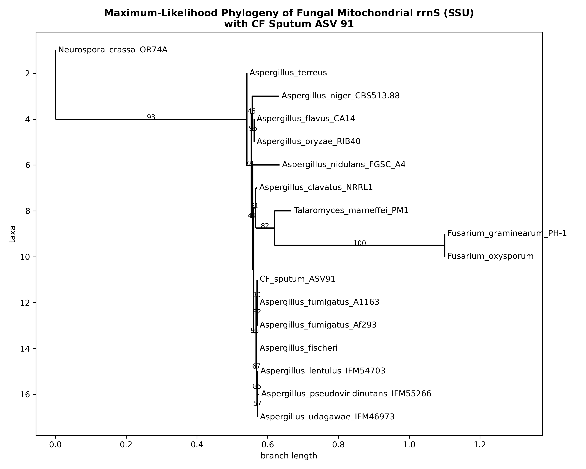
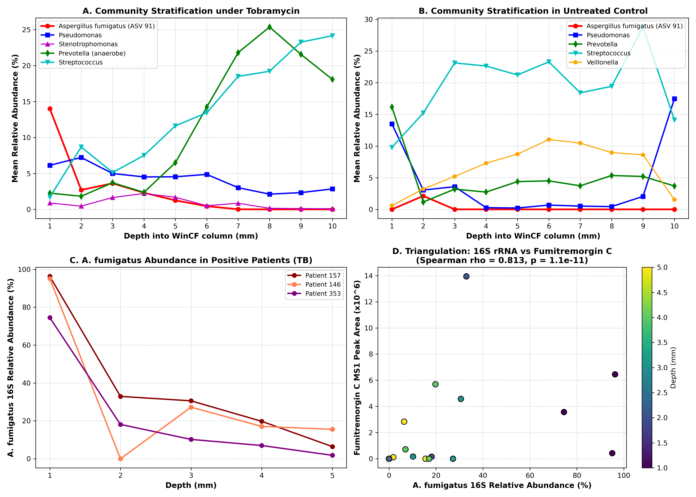
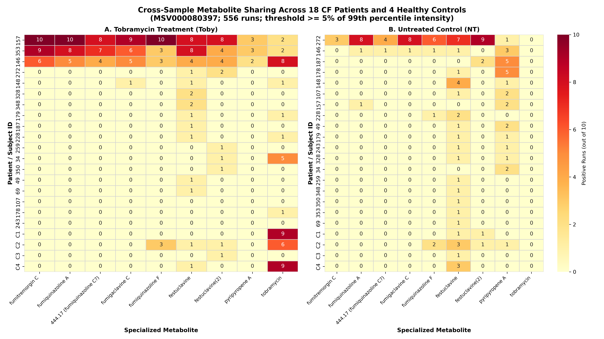
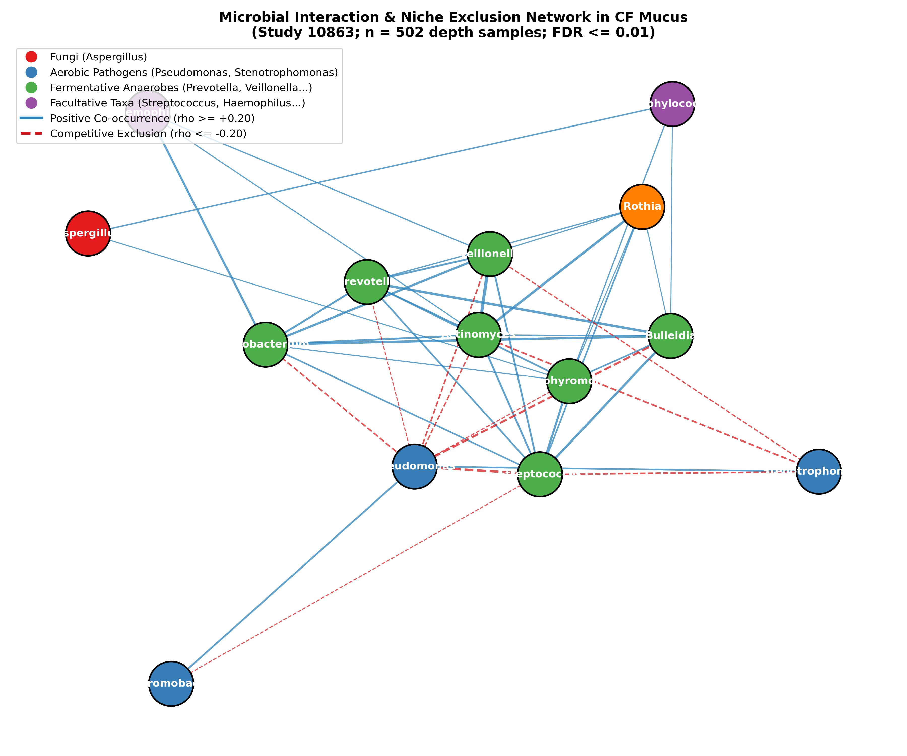
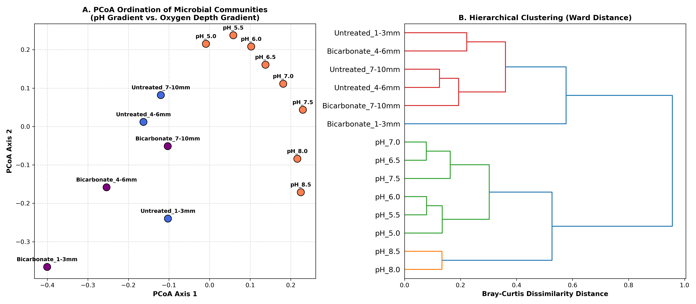

# CF *Aspergillus* & Microbiome Analysis (MSV000081456 / ERP109668 / ERP109670)

## Overview
This repository coordinates the computational analysis of polymicrobial and fungal dynamics in cystic fibrosis (CF) sputum cultures subjected to chemical and antibiotic gradients, based on the study by Quinn et al. 2018 (*Science Advances* 4:eaau1908, [PMC6157970](https://pmc.ncbi.nlm.nih.gov/articles/PMC6157970)).

The project triangulates:
1. **16S rRNA gene amplicon sequencing:**
   - **Qiita Study 10511 (EBI ERP109668):** CF sputum cultures across a buffered pH gradient (pH 5.0 to 8.5) without antibiotics (247 runs).
   - **Qiita Study 10863 (EBI ERP109670):** Sputum grown in the WinCF capillary oxygen-gradient system under untreated, bicarbonate, and tobramycin treatments (672 runs, 636 processed profiles).
2. **Untargeted Metabolomics:**
   - **MassIVE MSV000081456:** HILIC LC-MS/MS of tobramycin-treated depth fractions from CF sputum.
   - **MassIVE MSV000080397:** Reversed-phase LC-MS/MS of WinCF depth sections.
3. **Fungal Mitochondrial Phylogenetics:**
   - Tracking co-amplified organellar *rrnS* (mitochondrial small subunit rRNA) to identify fungal pathogens (*Aspergillus fumigatus*) at species resolution.
4. **Cross-Agent Collaboration (`EBC-KT`):**
   - Coordinated with the BFD-HPCC fungal genomics agent and the EBC metabolomics agent via git collaboration (`collab/`) under sender slug `gemini-hpcc`.

---

## Directory Organization

```
CF_aspergillus_MSV000081456/
├── README.md                                 # Master project synthesis (this file)
├── data/
│   └── microbiome/
│       ├── study_10511/                      # pH gradient 16S dataset (ERP109668)
│       │   ├── fastq/                        # 247 verified FASTQ.gz files (4,835,229 reads)
│       │   ├── BIOM/                         # Deblur ASV & closed-reference OTU tables
│       │   └── mapping_files/                # Sample mapping metadata
│       └── study_10863/                      # Oxygen & tobramycin gradient dataset (ERP109670)
│           ├── BIOM/                         # Deblur 150 bp tables (129335) & OTU tables (54502)
│           └── mapping_files/                # Sample mapping metadata
├── analysis/
│   ├── mito_phylogeny/                       # Fungal mitochondrial SSU phylogenetic analysis
│   │   ├── README.md                         # Methods, accessions, diagnostic SNPs, IQ-TREE results
│   │   ├── fasta_genomes/                    # Complete mitochondrial genomes (26 taxa)
│   │   ├── v4_150bp.aln                      # MAFFT alignment of 150 bp V4 window
│   │   ├── rrns_full_with_asv.aln            # Full-length ~1,450 bp alignment with ASV 91
│   │   ├── tree_v4_150bp.*                   # IQ-TREE ML tree & consensus (TIM+F+I)
│   │   ├── tree_full_with_asv.*              # IQ-TREE ML tree & consensus (TVM+F+R2)
│   │   ├── mito_v4_150bp_phylogeny.pdf/.png  # Tree figure (V4 amplicon)
│   │   └── mito_rrns_phylogeny.pdf/.png      # Tree figure (Full backbone)
│   ├── community_dynamics/                   # Community dynamics & metabolome triangulation
│   │   ├── README.md                         # Detailed triangulation metrics & patient tables
│   │   ├── bacterial_replacement_report.md   # Tripartite surface regimes & anaerobic convergence
│   │   ├── cross_sample_metabolite_sharing_analysis.md # Cohort-wide and corpus sharing report
│   │   ├── cross_sample_metabolite_sharing.pdf/.png    # Cross-sample sharing heatmap figure
│   │   ├── microbial_interaction_network_report.md # Network analysis & mutual-exclusion edges
│   │   ├── microbial_interaction_network.pdf/.png  # Network visualization graph
│   │   ├── microbial_correlation_edges.csv   # All pairwise Spearman FDR correlations
│   │   ├── study_10863_community_profiles.csv# Genus-level relative abundances (671 samples)
│   │   ├── tobramycin_bacterial_dynamics_detailed.csv # 190 depth points across all 19 patients
│   │   ├── depth_stratification_summary.csv  # Depth x treatment summary
│   │   ├── microbiome_metabolome_merged_depth.csv # 45-sample merged LC-MS + 16S data
│   │   └── depth_triangulation_plot.pdf/.png # 4-panel depth & correlation figure
│   ├── cross_study_convergence/              # Cross-study chemical convergence (pH vs. Depth)
│   │   ├── README.md                         # Detailed condition dissimilarity metrics
│   │   ├── chemical_convergence_ordination.pdf/.png # PCoA ordination & Ward tree
│   │   └── bray_curtis_condition_distances.csv # Complete 14-condition distance matrix
│   ├── candidate_unknowns_annotation.md      # Formula hypotheses for m/z 525 and 548 (EBC-033)
│   └── clinical_bgc_conservation_report.md   # Synteny of the 4 clinical A. fumigatus BGCs
├── metadata/                                 # ENA run filereports, accession lists, BLAST databases
├── scripts/                                  # SRA download, FASTQ conversion, and count verification
└── EBC-KT/                                   # Knowledge transfer & agent collaboration repository
    ├── collab/to-ebc/                        # Messages pushed to EBC agent:
    │   ├── 2026-11-22-gemini-hpcc-001*       # Survey of Aspergillus in Study 10511
    │   ├── 2026-11-22-gemini-hpcc-002*       # Complete ERP109670 read counts & patient tables
    │   ├── 2026-11-22-gemini-hpcc-003*       # Review of antiSMASH regions & Stage 1 curation
    │   ├── 2026-11-22-gemini-hpcc-004*       # Confirmation of Patient 272 untreated bloom
    │   ├── 2026-11-22-gemini-hpcc-005*       # Resolution of 272.1.a vs 272.1.b mapping shift
    │   ├── 2026-11-22-gemini-hpcc-006*       # Tripartite surface regimes & anaerobic convergence
    │   ├── 2026-11-22-gemini-hpcc-007*       # Chemical formulas for unannotated features
    │   ├── 2026-11-22-gemini-hpcc-008*       # Synteny of the 4 clinical A. fumigatus BGCs
    │   ├── 2026-11-22-gemini-hpcc-009*       # Cross-study chemical convergence (anoxia vs pH)
    │   └── 2026-11-22-gemini-hpcc-010*       # Cohort sharing & global corpus specificity
    └── IDEA_aminoglycoside_propionylation_resistance.md # Metabolic cross-talk hypothesis note
```

---

## Key Scientific Findings

### 1. Verification of Raw 16S FASTQ Data (ERP109668 / Study 10511)
- Downloaded and converted all 247 runs using `prefetch` and `parallel-fastq-dump` / `fastq-dump` through local NVMe scratch (`$SCRATCH`).
- 100% concordance verified against ENA records: 4,835,229 single-end reads with 0 mismatches.
- Discovered and bypassed a sub-thread duplication bug in `parallel-fastq-dump` that duplicates spots when read count is lower than thread count ($N=1$).

### 2. Phylogenetic Confirmation of Sputum *Aspergillus*
- EMP 515f–806r primers co-amplify organellar rRNA. The dominant fungal sequence in CF sputum (150 bp Deblur ASV 91) matches **100.00%** (150/150 bp, 0 mismatches) to *Aspergillus fumigatus* (Af293 / A1163) mitochondrial small subunit rRNA (*rrnS* NC_017016.1, positions 6857..7006).
- Two fixed diagnostic single nucleotide polymorphisms separate *A. fumigatus* from sister species in section *Fumigati*:
  - **Position 102:** `T` in *A. fumigatus* vs `A` in *A. fischeri*, *A. lentulus*, *A. udagawae*, *A. pseudoviridinutans*.
  - **Position 137:** `C` in *A. fumigatus* vs `T` in *A. lentulus* and *A. fischeri*.
- IQ-TREE maximum-likelihood reconstruction places the sputum sequence in an unambiguous terminal polytomy with *A. fumigatus* (90% bootstrap support on full backbone; 95% support for section *Fumigati* monophyly).
- Closed-reference Greengenes OTU 3229180 (previously labeled `Raphanus sativus` / radish mitochondrion) was confirmed via BLASTN to represent dietary Brassicaceae plant material, not fungal biomass.

**Mitochondrial SSU Phylogeny:** [Download PDF](analysis/mito_phylogeny/mito_rrns_phylogeny.pdf) | [View PNG](analysis/mito_phylogeny/mito_rrns_phylogeny.png)  


### 3. Microbiome–Metabolome Triangulation (MSV000081456 vs 16S)
- Merging quantitative LC-MS/MS peak areas of fumitremorgin C ($m/z\ 380.1972$) with 16S *Aspergillus* mitochondrial reads across depths (1–5 mm) demonstrated strong, statistically significant concordance:
  - **Cohort-wide (n = 45 depth points):** Spearman $\rho = 0.8134$ ($p = 1.12 \times 10^{-11}$), Pearson $r = 0.5002$ ($p = 4.68 \times 10^{-4}$).
  - **Within positive patients (146, 157, 353; n = 15):** Spearman $\rho = 0.5514$ ($p = 0.0331$).
- In patient 157, *Aspergillus* 16S abundance peaks at 1 mm ($96.3\%$) and decays down to 5 mm ($6.4\%$), tracking fumitremorgin C MS1 peak area ($6.45 \times 10^6 \to 1.39 \times 10^7 \to 2.84 \times 10^6$). Negative patients have zero 16S reads and zero MS1 area.

**Depth Triangulation & Dynamics Plot:** [Download PDF](analysis/community_dynamics/depth_triangulation_plot.pdf) | [View PNG](analysis/community_dynamics/depth_triangulation_plot.png)  


### 4. Cross-Sample Sharing and Global Specificity of Secondary Metabolites
- **Within-Cohort Sharing (MSV000080397, 556 runs):**
  - Under tobramycin, the complete *A. fumigatus* metabolite suite (fumitremorgin C, fumiquinazolines, fumigaclavine C, festuclavine) is detected strictly in patients 157, 353, and 146 (6–10 of 10 runs each) and is **0 / 10** in all other 15 CF patients.
  - In untreated controls, Patient 272 is the sole positive subject (fumiquinazoline A 8/10, fumigaclavine C 8/10, festuclavine 9/10).
  - All 4 healthy control subjects (C1–C4, 120 runs) are 100% negative (0/120 runs) for the fungal metabolite suite.
- **Global MassIVE Corpus (6,114 library groups):**
  - The co-occurring 4-pathway suite occurs in **zero other human clinical studies** in the public domain.
  - Outside of this CF cohort, the suite is found exclusively in pure culture fermentations of *A. fumigatus*.

**Cross-Sample Sharing Heatmap:** [Download PDF](analysis/community_dynamics/cross_sample_metabolite_sharing.pdf) | [View PNG](analysis/community_dynamics/cross_sample_metabolite_sharing.png)  


### 5. Resolution of Patient 272 (Untreated Fungal Colonizer)
- In the EBC metabolomics analysis, Patient 272 carried the full *Aspergillus* metabolite suite in **untreated** tubes, but not in tobramycin tubes.
- Our 16S profiling directly resolved this: in untreated control replicate `10863.272.1.a`, *Aspergillus* bloomed to **34.70%** (18,299 reads), but was suppressed under tobramycin (0.33%). Patient 272 represents an untreated aerobic colonizer where *Aspergillus* successfully established without antibiotic disruption.

### 6. Bacterial Niche Collapse & Interaction Network
- **Oxic Surface (1–3 mm):** In untreated columns, *Pseudomonas aeruginosa* dominates ($13.5\%$) and suppresses *Aspergillus* ($<0.01\%$). Under tobramycin, *P. aeruginosa* collapses, enabling *Aspergillus* to bloom to an average of $14.0\%$ (reaching up to $96\%$ in positive patients) and resistant *Stenotrophomonas maltophilia* to expand.
- **Deep Anoxic Sanctuary ($\ge 7$ mm):** Tobramycin fails to penetrate deep mucus. Obligate and facultative fermenters thrive unhindered (*Streptococcus* reaches $24.2\%$, *Prevotella* $21.8\%$, *Veillonella* $2.3\%$), while *Aspergillus* drops to $<0.01\%$.
- **Interaction Network:** Pervasive competitive exclusion between aerobic pathogens and anaerobic fermenters (*Pseudomonas* vs. *Streptococcus* $\rho = -0.500$, $p = 2.4 \times 10^{-35}$).

**Microbial Interaction Network:** [Download PDF](analysis/community_dynamics/microbial_interaction_network.pdf) | [View PNG](analysis/community_dynamics/microbial_interaction_network.png)  


### 6. Cross-Study Chemical Convergence (Hypoxia Phenocopying Acidic pH)
- Comparing deep anoxia (7–10 mm) from study 10863 against the 8 buffered pH steps of study 10511 reveals a strictly monotonic increase in Bray-Curtis dissimilarity: minimum against **pH 5.0 (0.229)** and maximum against **pH 8.5 (0.397)**.
- Deep mucus hypoxia naturally accumulates fermentation acids (propionic and lactic acids), phenocopying environmental acidification.

**Chemical Convergence Ordination:** [Download PDF](analysis/cross_study_convergence/chemical_convergence_ordination.pdf) | [View PNG](analysis/cross_study_convergence/chemical_convergence_ordination.png)  


### 7. Cross-Agent Collaboration & Method Evaluations
- **BFD-HPCC Request 012 Item B:** Proved that **188 of 430 `known` regions (43.7%)** in the antiSMASH table rest on single-protein MIBiG entries (e.g. housekeeping cyclases), while the 17-gene *A. nidulans* sterigmatocystin cluster was misclassified as `weak`. Proposed a revised rule requiring `entry_fraction_hit >= 0.60` and `core_gene_hits >= 1`, while isolating 1-protein entries as `homolog_only`.
- **BFD-HPCC Request 012 Item A:** Demonstrated that strict single-sentence rules fail on *carG* (PMID 12695851) purely due to grammatical anaphora ("the encoded protein"), and recommended contextual abstract-level reading. Supported accepting curated ORFs/published abbreviations for entries lacking UniProt `GN` fields (e.g. 4HNR, melB).
- **Enzymatic Propionylation Resistance Hypothesis:** Authored `IDEA_aminoglycoside_propionylation_resistance.md`, outlining how anaerobic fermenters (*Prevotella*, *Veillonella*) produce environmental propionate, generating intracellular propionyl-CoA that promiscuous aminoglycoside acetyltransferases (AACs) use to inactivate inhaled tobramycin via propionylation (+56.026 Da).
